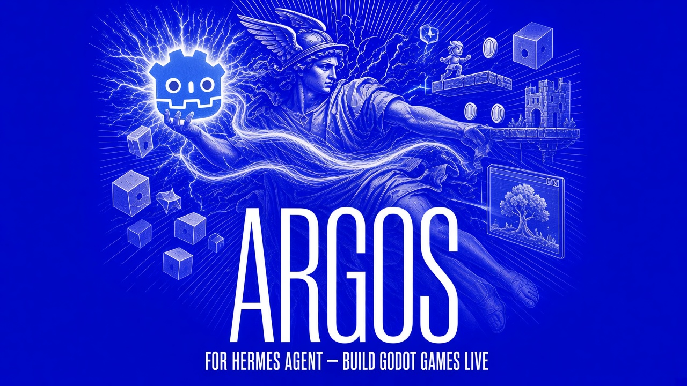

# ARGOS — proposal for the Nous catalog

**Bilingual:** English first, Spanish from [Español](#español).

| | |
|---|---|
| Plugin name | `argos` |
| Version | `1.1.0` |
| Author | Tormen (GitHub `Tormen28`) |
| Repo | `github.com/Tormen28/argos` |
| License | MIT |
| Category | Game development · Godot |

---

## 1 · What it is

ARGOS gives a Hermes agent **hands on a live Godot editor**. Instead of writing a
`.tscn` file and asking you to open it, the agent opens the scene, builds nodes,
sets properties, runs the game, takes a screenshot, and reads the result back.

Three pieces:

1. **Editor addon** — lives inside Godot, exposes an HTTP API on loopback.
2. **MCP server** — 27 tools the agent can call: scene tree, node create/delete,
   set/get property, instantiate, reparent, scene open/save/reload/new, run/stop
   play, capture, undo/redo, history, filesystem scan, status.
3. **Hermes plugin** — registers the server and the skill so the agent knows how
   to use it.

## 2 · Why it belongs in the catalog

Most game-dev tooling for agents stops at “generate a file”. The hard part of game
work is the loop: change → **see it** → change again. ARGOS closes that loop. An
agent that can screenshot a running Godot scene can fix its own work.

It also demonstrates the pattern the catalog needs: **the agent drives the real
tool, not a mock of it**.

## 3 · What the agent can do with it

| Task | Tool |
|---|---|
| See what's in the scene | `argos_scene_tree` |
| Build a level | `argos_node_create`, `argos_node_instantiate`, `argos_node_reparent` |
| Tune anything | `argos_node_set_prop`, `argos_node_get_prop` |
| Open/save work | `argos_scene_open`, `argos_scene_save`, `argos_scene_new` |
| **See the result** | `argos_capture_scene`, `argos_runtime_capture` |
| Run and stop the game | `argos_run_play`, `argos_run_stop` |
| Undo a mistake | `argos_undo`, `argos_redo`, `argos_history` |
| Check it's alive | `argos_ping`, `argos_status`, `argos_check` |

## 4 · Honest state

| | |
|---|---|
| Verified | Addon installs; the 27 tools respond; scene tree, node creation, property reads and captures work against a real Godot 4 project |
| Godot version | 4.x (tested on the machine's 4.7 build) |
| Not verified | A full agent-driven session that builds a playable scene end to end without a human clicking |
| Risk | Godot must be open with the addon enabled; if the editor is closed, every call fails with a clear error |

## 5 · Security posture

- Loopback HTTP only; the addon listens on `127.0.0.1`.
- No network calls out.
- The agent can only touch what the Godot project has open.
- No credentials anywhere in the addon or the MCP server.

---

# Español

Bilingüe: inglés arriba, español aquí.

| | |
|---|---|
| Nombre del plugin | `argos` |
| Versión | `1.1.0` |
| Autor | Tormen (GitHub `Tormen28`) |
| Repositorio | `github.com/Tormen28/argos` |
| Licencia | MIT |
| Categoría | Desarrollo de juegos · Godot |

## 1 · Qué es

ARGOS le da a un agente de Hermes **manos sobre un editor de Godot vivo**. En vez
de escribir un `.tscn` y pedirte que lo abras, el agente abre la escena, construye
nodos, ajusta propiedades, ejecuta el juego, toma una captura y lee el resultado.

Tres piezas:

1. **Addon del editor** — vive dentro de Godot y expone un API HTTP en loopback.
2. **Servidor MCP** — 27 herramientas que el agente puede llamar: árbol de escena,
   crear/borrar nodos, poner y leer propiedades, instanciar, reparentar, abrir y
   guardar y crear escenas, ejecutar y parar el juego, capturar, deshacer y rehacer,
   historial, escaneo del sistema de archivos y estado.
3. **Plugin de Hermes** — registra el servidor y la skill, para que el agente sepa
   cómo usarlo.

## 2 · Por qué merece estar en el catálogo

Casi toda la herramienta de desarrollo de juegos para agentes se queda en «genera
un archivo». Lo difícil del trabajo de juegos es el bucle: cambio → **lo veo** →
cambio otra vez. ARGOS cierra ese bucle. Un agente que puede capturar una escena
de Godot corriendo puede corregir su propio trabajo.

Además demuestra el patrón que el catálogo necesita: **el agente maneja la
herramienta real, no una imitación**.

## 3 · Qué puede hacer el agente con esto

| Tarea | Herramienta |
|---|---|
| Ver qué hay en la escena | `argos_scene_tree` |
| Construir un nivel | `argos_node_create`, `argos_node_instantiate`, `argos_node_reparent` |
| Ajustar cualquier cosa | `argos_node_set_prop`, `argos_node_get_prop` |
| Abrir y guardar trabajo | `argos_scene_open`, `argos_scene_save`, `argos_scene_new` |
| **Ver el resultado** | `argos_capture_scene`, `argos_runtime_capture` |
| Ejecutar y parar el juego | `argos_run_play`, `argos_run_stop` |
| Deshacer un error | `argos_undo`, `argos_redo`, `argos_history` |
| Comprobar que está vivo | `argos_ping`, `argos_status`, `argos_check` |

## 4 · Estado honesto

| | |
|---|---|
| Verificado | El addon se instala; las 27 herramientas responden; árbol de escena, creación de nodos, lectura de propiedades y capturas funcionan contra un proyecto Godot 4 real |
| Versión de Godot | 4.x (probado con la 4.7 de esta máquina) |
| No verificado | Una sesión completa dirigida por el agente que construya una escena jugable de principio a fin sin que una persona haga clic |
| Riesgo | Godot tiene que estar abierto con el addon activo; si el editor está cerrado, toda llamada falla con un error claro |

## 5 · Postura de seguridad

- Solo HTTP en loopback; el addon escucha en `127.0.0.1`.
- Ninguna llamada hacia fuera.
- El agente solo puede tocar lo que el proyecto de Godot tenga abierto.
- Sin credenciales en el addon ni en el servidor MCP.
