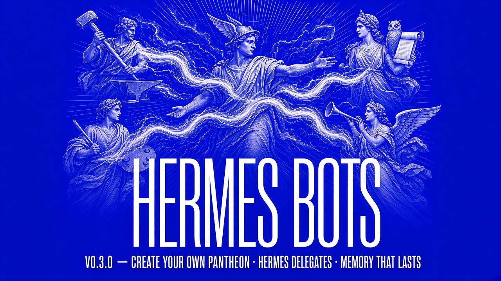

# Hermes Bots — proposal for the Nous catalog

**Bilingual:** English first, Spanish from [Español](#español).

| | |
|---|---|
| Plugin name | `hermes-bot-chat-agent` |
| Version proposed for catalog | `0.3.0` |
| Current state | `0.3.0-dev` — private cut, `main` stays on `0.2.0` until merged |
| Manifest version | 2 |
| Author | Tormen (GitHub `Tormen28`) |
| Repo | `github.com/Tormen28/hermes-bot-chat-agent` |
| Category | Agents · Team orchestration |

---

## 1 · What it is

Bot Chat turns Hermes into a **conversation you can trust with the reins**:
it replies short, acts instead of narrating, refuses the dangerous things by
itself, and when you give it teammates it dispatches work to them instead of
pretending it did.

Three layers, one plugin:

1. **Reply style** (`pre_llm_call`) — short ack, then act. One question per turn,
   only when truly blocked. No inner monologue in the reply.
2. **Safety guard** (`pre_tool_call`) — a configurable wall in front of secrets,
   deletes, destructive git, protected-branch pushes, outbound messages and
   expensive models. It only blocks; it never approves.
3. **Desktop surface** — status bar above the composer: `Working… · <activity>`,
   `Waiting on <god>`, `Done · 
`, `Waiting for your OK`, `Error:`.

## 2 · What 0.3.0 adds

- **Real delegation.** With `team.gods` listing actual profile names, Bot Chat
  creates kanban subcards assigned to those profiles — and a hook **refuses to
  close** a card (or an ancestor that still has it open) until the board shows it
  `done`. The assignee's own dispatcher can still deliver.
- **Kanban lock.** No direct `kanban.db` writes, no mutating `hermes kanban` shell
  calls from the conversation, no user impersonation, no pre-finished cards, and
  an idempotency key on `kanban_create` when one is missing.
- **Guard presets.** `strict`, `default`, `relaxed` — packaging the existing rule
  groups with optional per-rule overrides. `relaxed` keeps the lock and turns off
  wait-for-god.
- **Subagent inheritance.** The guard covers `delegate_task` and child sessions
  spawned from a canonical Bot Chat session, so a subagent cannot slip past the
  wall its parent respects.

## 3 · Why it belongs in the catalog

Most agent tooling sells autonomy. This one sells **containment**: the agent is
allowed to be fast because it is not allowed to be careless. That is the property
a catalog has to be able to certify, and it is testable here — every rule is a
hook with a clear refusal and a clear message.

## 4 · Honest state

| | |
|---|---|
| Works | Reply style, guard rules, presets, kanban lock, desktop status |
| Version status | `0.3.0-dev`. It is **not** released: `main` is still `0.2.0` |
| Not done | The branch is not merged; no release tag; catalog proposal needs the merge first |
| Blocking decision | Whether `0.2.0` (safe, no delegation) or `0.3.0` (delegation + lock) is what gets proposed |

That last row is a real decision, not a formality: `0.3.0` changes how the agent
behaves when it has teammates, and that is a product call.

---

# Español

Bilingüe: inglés arriba, español aquí.

| | |
|---|---|
| Nombre del plugin | `hermes-bot-chat-agent` |
| Versión propuesta para catálogo | `0.3.0` |
| Estado actual | `0.3.0-dev` — corte privado, `main` sigue en `0.2.0` hasta que se fusione |
| Autor | Tormen (GitHub `Tormen28`) |
| Repositorio | `github.com/Tormen28/hermes-bot-chat-agent` |
| Categoría | Agentes · Orquestación de equipo |

## 1 · Qué es

Bot Chat convierte a Hermes en **una conversación a la que le puedes dar las
riendas**: responde corto, actúa en vez de narrar, rechaza por sí solo lo
peligroso, y cuando le das compañeros de equipo reparte el trabajo de verdad en
vez de fingir que lo hizo.

Tres capas, un solo plugin:

1. **Estilo de respuesta** (`pre_llm_call`) — acuse corto y a trabajar. Una sola
   pregunta por turno, y solo cuando de verdad hay un bloqueo. Nada de monólogo
   interno en la respuesta.
2. **Guardia de seguridad** (`pre_tool_call`) — un muro configurable delante de
   secretos, borrados, git destructivo, push a ramas protegidas, mensajes al
   exterior y modelos caros. Solo bloquea; nunca aprueba.
3. **Superficie de escritorio** — barra de estado encima del compositor:
   `Working… · <actividad>`, `Waiting on <dios>`, `Done · <resumen>`,
   `Waiting for your OK`, `Error:`.

## 2 · Qué añade la 0.3.0

- **Delegación real.** Con `team.gods` listando nombres reales de perfil, Bot Chat
  crea subtarjetas en el kanban asignadas a esos perfiles — y un hook **se niega a
  cerrar** una tarjeta (o un ancestro que todavía la tenga abierta) hasta que el
  tablero la muestre `done`. El despachador del propio asignado puede entregar
  igual.
- **Candado del kanban.** Nada de escrituras directas a `kanban.db`, nada de
  llamadas mutantes a `hermes kanban` desde la conversación, nada de suplantar al
  usuario, nada de tarjetas ya terminadas antes de tiempo, y clave de idempotencia
  en `kanban_create` cuando falta.
- **Presets de guardia.** `strict`, `default`, `relaxed` — empaquetan los grupos de
  reglas existentes con anulaciones por regla. `relaxed` mantiene el candado y
  apaga la espera por el dios.
- **Herencia en subagentes.** La guardia cubre `delegate_task` y las sesiones hijas
  nacidas de una sesión Bot Chat canónica, para que un subagente no se cuele por
  donde su padre sí respeta.

## 3 · Por qué merece estar en el catálogo

Casi toda la herramienta de agentes vende autonomía. Esta vende **contención**: el
agente puede ser rápido porque no tiene permitido ser descuidado. Esa es la
propiedad que un catálogo tiene que poder certificar, y aquí es comprobable — cada
regla es un hook con un rechazo claro y un mensaje claro.

## 4 · Estado honesto

| | |
|---|---|
| Funciona | Estilo de respuesta, reglas de guardia, presets, candado del kanban, estado de escritorio |
| Estado de versión | `0.3.0-dev`. **No** está publicada: `main` sigue en `0.2.0` |
| Sin hacer | La rama no está fusionada; no hay etiqueta de release; la propuesta necesita esa fusión primero |
| Decisión que bloquea | Si se propone `0.2.0` (segura, sin delegación) o `0.3.0` (delegación y candado) |

Esa última fila es una decisión real, no un trámite: la `0.3.0` cambia cómo se
comporta el agente cuando tiene compañeros, y eso es una decisión de producto.
